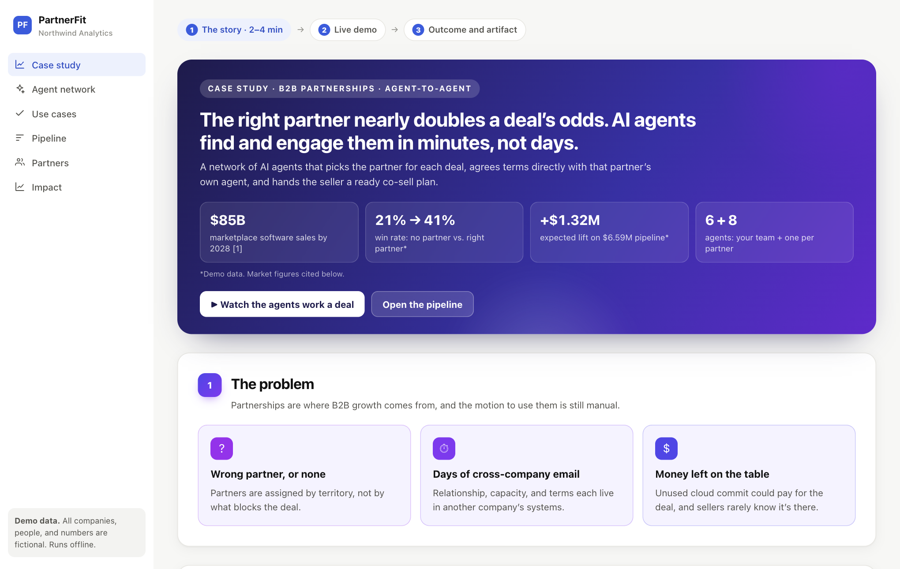
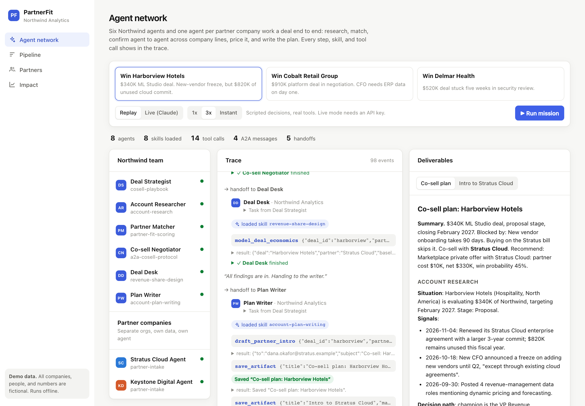

# PartnerFit

**AI agents that find the right partner for every B2B deal, and agree terms directly with that partner's own agent.**



## In one minute

| | |
|---|---|
| **Problem** | The right partner can nearly double a deal's win rate, but sellers pick partners by territory, and confirming fit, capacity, and terms takes days of email between companies. |
| **Opportunity** | Software sold through cloud marketplaces grows from $16B to **$85B by 2028**, more than half of it through partners ([Canalys](https://canalys.com/newsroom/hyperscaler-cloud-marketplace)). |
| **Solution** | A team of six AI agents researches the deal, picks the partner that removes the blocker, confirms with the partner's own agent, prices the deal, and writes the plan. |
| **Result (demo)** | Win probability **21% → 45%** on a sample deal, **+$1.3M** expected lift across a $6.6M pipeline, and a ready co-sell plan in one run. |

## How it works

**Research → Match → Confirm with the partner's agent → Price → Deliver.** Each company's agent uses only its own data. Every agent follows a short written playbook (a "skill") that the business owns. Every step is visible in a live trace.



## See it

```bash
npm install
npm run dev
```

Open the app and click through four tabs: **Case study** (the story), **Agent network** (live demo), **Use cases**, and **Impact**.

It runs offline on sample data. Add `ANTHROPIC_API_KEY` to run the same agents live on Claude.

---

<sub>Built with React and TypeScript, a custom agent runtime with Agent Skills and agent-to-agent messaging, and the Anthropic API for live mode. All companies and figures in the demo are fictional. MIT license.</sub>
